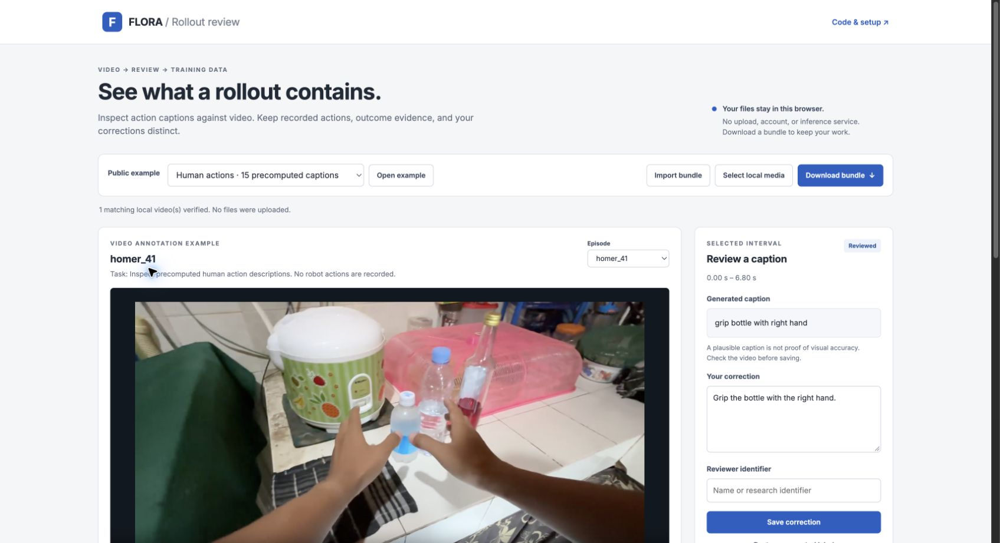
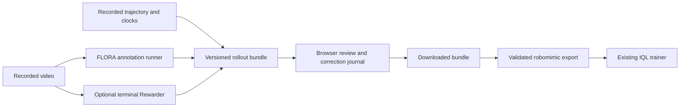

# Recorded rollouts → reviewed labels → offline RL

Connect robot video and recorded actions to an existing training stack. Inspect
captions against video, keep corrections and outcome evidence separate, and
export aligned state/action transitions for **robomimic IQL**. You do not need
to rebuild source checks, clock alignment, review history, or export plumbing.

**[Open the public review demo](https://flora-rollout-review.exact-leaf-7339.chatgpt.site)**
— opens without an account.



The examples make the evidence visible: one human video has **15 real precomputed
FLORA captions**; one Panda simulator rollout has **59 recorded transitions**
and a CPU-rendered replay. The robot example's FLORA captions and Rewarder
scores are unavailable. The replay shows recorded data, not a trained policy.

## What you provide and receive

| Input | Available output |
| --- | --- |
| Video or video manifest | Native TempSeg/Captioner annotations, stage status, resume, review, label JSONL |
| Recorded observations/actions plus source clocks | Versioned trajectory bundle, synchronized inspection, robomimic HDF5 export |
| Whole episode, explicit task, supported cameras | Optional independent Rewarder request and result; native execution awaits validation |

Browser review needs no account or model weights. Selected local files stay in
the browser. The lightweight CPU package validates bundles and exports datasets.
Native inference needs separately prepared models, a supported environment, and
sufficient GPU memory. Installing the package does not supply those requirements.

## Try the workflow

In the demo, select an interval, play its video, enter a reviewer identifier, and
save a correction. Download the bundle and import it again. The original caption
and full correction history remain separate. To inspect your own bundle, choose
**Import bundle**, then explicitly select its matching local video. Media hashes
must match; the page does not upload your files or start inference.

Install the versioned lightweight package with Python 3.11 or 3.12:

```sh
python3.11 -m venv .venv
. .venv/bin/activate
pip install 'batch-inference-robotics[data] @ git+https://github.com/sabdulmajid/batch-inference-robotics.git@v0.3.0'
bir resources --output-dir bir-resources
bir bundle-check --bundle bir-resources/web/examples/robot.bir.json
```

Resources are included in the wheel and can be extracted outside a checkout.
For a downloaded browser bundle, replace the final path with that file.
See the [complete quickstart](docs/ROLLOUT_QUICKSTART.md) for all five workflows.

The package also includes a [ready-to-load 117-transition HDF5 and bundle](examples/rl/README.md).
To start from the source, download the pinned 21 MB Lift dataset, retain its two selected
demonstrations, and export their **117 original transitions**:

```sh
python bir-resources/scripts/prepare_rollout_example.py \
  --dataset data/lift.hdf5 --download-only
bir trajectory-import --dataset data/lift.hdf5 \
  --demos demo_0 demo_1 --output lift.bir.json
bir training-export --bundle lift.bir.json --output lift-iql.hdf5 \
  --reward-source environment --boundary-mode source-mask
```

The reward source and bootstrapping policy are explicit. This source's original
`dones` combines success and recording-end flags; it does not prove physical
termination. The export retains that source convention without inventing terminal
events. A label-only video cannot supply missing actions or next observations.

Run the bounded CPU IQL recipe in its [separate pinned environment](docs/ROLLOUT_QUICKSTART.md#4-run-the-cpu-iql-integration):

```sh
python bir-resources/scripts/rl_cpu_smoke.py --dataset lift-iql.hdf5 \
  --output iql-smoke --steps 20 --rollouts 2 --horizon 400 --threads 2
```

This uses the existing IQL algorithm, not a new trainer. It checks actor, critic,
and value updates; saves and reloads a checkpoint; performs a further update;
and executes the saved policy in fresh simulator episodes. Captions and
retrospective scores are excluded from policy observations.

## Native annotations and optional outcome scoring

The existing annotation commands remain available with the separately prepared
[native environment and hardware](docs/QUICKSTART.md#prepare-the-native-environment-and-hardware):

```sh
bir annotate --videos VIDEO_FOLDER --source FLORA_SOURCE --run-dir runs/my-data
bir status --run-dir runs/my-data
bir review --run-dir runs/my-data --open
bir export --run-dir runs/my-data --output labels.jsonl
```

With the same engine, runtime, and configuration, repeat the annotation command to resume completed stages. Use the recorded release to resume older inference runs; upgrading does not prevent inspection or export of their saved results. The accelerated
input path preserves native pixels and timestamps, removes repeated PNG
serialization, and overlaps preparation with generation. Native annotation was
verified on three same-node RTX 3090 GPUs. This is not a guarantee that every
input fits; two baseline episodes exhausted memory.

The independent [Rewarder companion worker](docs/REWARDER.md) has its own source
identity, attempts, raw scores, parse checks, and recovery. Its CPU integration
boundary is tested. **Native Rewarder inference has not run for this release.**
Failures and missing scores remain unknown, never zero. The first supported
native profile targets one H100 80 GB and needs its own validation.

GPU work for this project remains paused: **18.563889/24 GPU-hours and 16/16
submissions** were used. The [bounded later validation proposal](docs/REWARDER.md#one-bounded-later-native-validation-proposal)
requires an explicit pause and submission-limit revision.

## Evidence and limits

| Capability | Evidence |
| --- | --- |
| Native annotation acceleration | **1.57×** on one preselected six-video block; 121 captions and 170 model inputs unchanged. Full eleven-video comparison incomplete after baseline OOM. [Report](docs/PHASE2_RESULTS.md) |
| Real trajectory export and CPU IQL | Two recorded Lift episodes, 117 transitions; 20 updates, exact checkpoint action/optimizer recovery, one further update. [CPU report](reports/rl-cpu-smoke.json) |
| Fresh policy execution | Two fresh 400-step simulator episodes, **0/2 task successes**. Integration smoke only; no learned-competence or policy-improvement claim. [Details](docs/TRAINER_INTEGRATION.md) |
| Rewarder | Parser, provenance, failure/recovery, and upstream CPU input boundary tested. Native inference pending. [Status](docs/REWARDER.md) |
| Public review | Browser-only imports, verified media, separate corrections, portable full-history bundle. Anonymous playback, correction, and download verified. |



The first trajectory adapter accepts the pinned robomimic Lift state-data
convention. It is not a universal robot adapter. Native annotations currently
have strongest evidence for short, single-view human manipulation videos.
The real robot replay has no native captions or outcomes. FLORA terminal reward
export requires genuine native scores and an established episode-ending
contract; the example's unknown endings cannot be silently reclassified.

Full correction history is in the bundle and `reviews.jsonl`. Annotation JSONL
contains the latest applicable correction and its provenance. Inapplicable
historical edits remain visible; they are not reassigned after resumed inference
changes a generated record. Reviewer names are supplied labels, not authenticated
ground truth. This is a research tool, not a production service or a learning
result.

See [installation and commands](docs/ROLLOUT_QUICKSTART.md),
[trajectory and trainer semantics](docs/TRAINER_INTEGRATION.md),
[native reproduction](docs/REPRODUCTION.md), and [current status](docs/STATUS.md).
FLORA retains NVIDIA's non-commercial research/evaluation restrictions.
Dataset and media licenses remain separate. Preserve the attribution in each
bundle and the [third-party notices](THIRD_PARTY_NOTICES.md).
